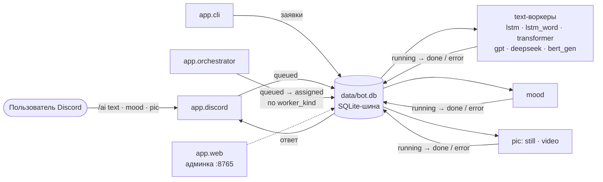
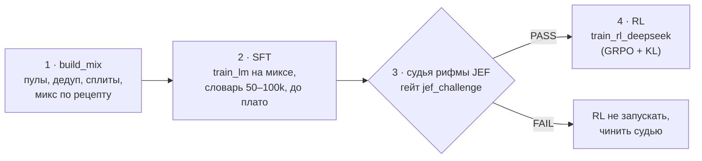

# KizaruAi

**Трансформер, который пишет русский рэп, — и Discord-бот вокруг него:** `/ai text` (генерация текста), `/ai mood` (настроение по двум осям) и `/ai pic` (символьная мозаика из картинок и видео).


Kizaru — только имя проекта. Код — [MIT](LICENSE); что можно публиковать (корпус, веса) — [docs/licensing.md](docs/licensing.md). Корпус, чекпоинты и `bot.db` в репозиторий не входят.

---

## Что умеет

- **`/ai text`** — продолжение текста одной из шести моделей: `lstm` (char), `lstm-word`, `transformer`, `gpt`, `deepseek` (MiniDeepSeek с MLA), `bert-gen` (MLM + Gibbs). Параметры: `start`, `temp`, `lines`, `length`, `iters`.
- **`/ai mood`** — классификация настроения: злой ↔ добрый и грустный ↔ весёлый (RNN, две sigmoid-оси). Текст берётся из параметра или из reply.
- **`/ai pic`** — картинка или видео → сетка глифов, режимы `simple`, `line`, `render`, `details`. Не нейросеть: яркость → глифы.
- **`/ai help`** — краткая справка в чате.
- **Админка** — `python -m app.web` → http://127.0.0.1:8765/
- **CLI без Discord** — те же заявки через `app.cli.generate` и `app.cli.image`.
- **Пайплайн переобучения** — сборка микса данных → SFT → гейт судьи рифмы → RL (в разработке, см. [Обучение](#обучение)).

## Демо

Режим `render` команды `/ai pic` на видео:

- [render pgr c320](https://www.youtube.com/watch?v=374Ua0c11UU)
- [Bad apple unicod render](https://www.youtube.com/watch?v=yNeDeC8j7tY)

## Быстрый старт

```powershell
# 1. Зависимости (глобальный Python 3.10 или venv)
python -m pip install -r requirements.txt

# 2. Секреты: скопировать шаблон и вписать DISCORD_TOKEN
Copy-Item .env.example .env

# 3. Все процессы бота разом: оркестратор, воркеры, Discord — каждый в своём окне
powershell -ExecutionPolicy Bypass -File .\start_all.ps1
#    опционально: -SkipDiscord / -SkipMood / -SkipPic

# 4. Админка
python -m app.web            # http://127.0.0.1:8765/
```

- Без `DISCORD_TOKEN` в `.env` скрипт `start_all.ps1` просто не запускает Discord-процесс. Логи — в `var/logs/`, шина `data/bot.db` создаётся при первом обращении.
- Воркерам нужны веса в `checkpoints/`: `kizaru.pt`, `kizaru_word.pt`, `transformer.pt`, `gpt.pt`, `deepseek.pt`, `bert_gen.pt`, `mood.pt` — обучите сами или положите готовые.
- Корпус для обучения (`data/corpus/kizaru_lyrics.txt`) собирается локально: `python -m training.prepare_data` (fallback) или через Genius.

Проверка без Discord (нужны оркестратор и воркер `lstm`):

```powershell
python -m app.cli.generate --arch lstm --start "Я" --db data/bot.db
python -m app.cli.image still path\to\picture.jpg --mode line
```

Пошаговый чеклист с нуля: **[docs/install.md](docs/install.md)**. Запуск по одному процессу, Genius, инвайт бота: **[docs/runbook.md](docs/runbook.md)**.

## Требования к стенду

| Что | Зачем | Обязательно |
|-----|-------|-------------|
| Python 3.10 | всё | да |
| Windows + PowerShell | `start_all.ps1` и ops-скрипты в `var/` | для деплоя через `start_all.ps1` |
| NVIDIA GPU с CUDA | обучение (инференс работает и на CPU) | для обучения |
| LLM-сервер с OpenAI-совместимым API — **llama-swap** или аналог (Qwen) | LLM-часть пайплайна (учитель/судья в RLAIF-цикле) | **да** для LLM-части; клиент в `core/llm/` пока не написан |
| MLflow-сервер (`http://127.0.0.1:5000`) | графики метрик обучения | нет — без него обучение работает (`KIZARU_MLFLOW=0`) |
| `ffmpeg` / `ffprobe` в PATH | GIF и видео в pic | для видео в `/ai pic` |

Python-пакеты — все в [`requirements.txt`](requirements.txt); зачем каждый — в [docs/install.md](docs/install.md#требования-к-стенду).

## Архитектура

Discord-процесс только ставит заявки; считают оркестратор и воркеры. Шина — SQLite `data/bot.db` (WAL, без Redis), статусы `queued` → `assigned` → `running` → `done` / `error`.



Полное дерево модулей и таблица `worker_kind`: [docs/architecture.md](docs/architecture.md).

## Структура проекта

```
KizaruAi/
├── app/            # процессы: discord, orchestrator, workers, web (админка), cli
├── core/           # библиотека: text (модели), mood, image (pic), corpus, bus (SQLite-шина), llm (заготовка)
├── training/       # обучение и данные: build_mix, train_lm, train_jef, jef_challenge, train_rl_deepseek, check_dataset
│   ├── mixes/      #   рецепты миксов (ru_rap_v1.yaml)
│   └── artist_pools/  # списки артистов Genius по пулам
├── experiments/    # bench.py, замороженные сплиты shared/, результаты турниров
├── tests/          # pytest
├── docs/           # документация (карта — docs/LINKS.md)
├── data/           # корпус, датасеты, эмбеддинги, bot.db (в репозиторий не входят)
├── database/       # описание схемы SQLite-шины
├── checkpoints/    # веса моделей
├── notebooks/      # ноутбуки и зонды глифов pic
├── var/            # рантайм: логи, temp, ops-скрипты ночных прогонов
├── logs/           # старые логи процессов
└── start_all.ps1   # запуск всех процессов бота
```

## Обучение

Слоты бота — обычные next-token LM (`bert-gen` — MLM): CrossEntropy + Adam, скрипты `training.train`, `training.train_lm`, `training.train_mood`.

Переобучение генератора русского рэпа идёт по плану из четырёх шагов, каждый со своими критериями приёмки:



```powershell
python -m training.build_mix --mix ru_rap_v1 --dry-run   # таблица пулов и план, ничего не пишет
python -m training.build_mix --mix ru_rap_v1             # -> data/mixes/ru_rap_v1/
python -m training.jef_challenge eval --judge checkpoints/jef_rhyme_lora
```

- План с критериями приёмки и разбором прошлого RL: **[docs/training-plan.md](docs/training-plan.md)**
- Все скрипты, флаги, MLflow, ops-скрипты: **[docs/training.md](docs/training.md)**
- Следующая идея — GRPO с наградой-функцией без модели-судьи: [docs/next-grpo-rule-reward.md](docs/next-grpo-rule-reward.md)

Пока идёт обучение, не поднимайте текстовые воркеры на той же GPU.

## Тесты

```powershell
python -m pytest -m "not slow"     # быстрый набор
python -m pytest -m slow           # тяжёлые smoke-тесты (мини-обучение на CPU)
```

Маркеры описаны в `pytest.ini` (`slow`, `integration`). В консоли Windows русский вывод скриптов может отображаться кракозябрами — помогает `$env:PYTHONIOENCODING = "utf-8"` перед запуском.

## Документация

| Документ | О чём |
|----------|-------|
| [docs/LINKS.md](docs/LINKS.md) | карта всей документации |
| [docs/install.md](docs/install.md) | первый запуск и требования к стенду |
| [docs/architecture.md](docs/architecture.md) | дерево модулей, процессы, шина заявок |
| [docs/runbook.md](docs/runbook.md) | запуск, корпус Genius, деплой, Discord, pic |
| [docs/training.md](docs/training.md) | скрипты обучения, build_mix, MLflow, ops-скрипты |
| [docs/training-plan.md](docs/training-plan.md) | план переобучения: микс → SFT → JEF → RL |
| [docs/next-grpo-rule-reward.md](docs/next-grpo-rule-reward.md) | GRPO с наградой-функцией (следующий шаг) |
| [docs/methods.md](docs/methods.md) | математика: CE, LSTM, attention, mood, pic |
| [docs/CURSOR_MISTAKES.md](docs/CURSOR_MISTAKES.md) | разбор ошибок агентов (контекст для Cursor) |
| [docs/licensing.md](docs/licensing.md) | что можно публиковать |
